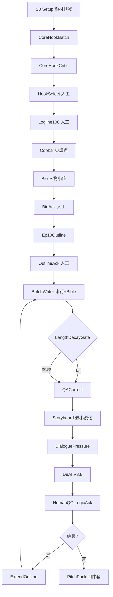
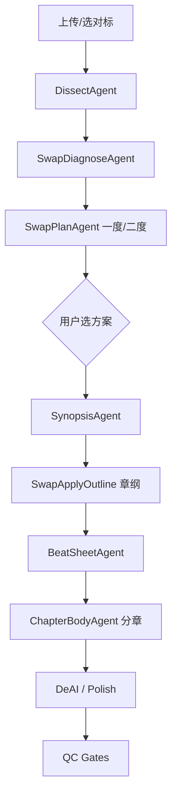

# 工作流编排与门禁（Gates）

> 参考：`agents方法论/硬核智能体工程`（done contract / check / receipt / handoff）  

> **运行时**：Node `agent-worker`（默认自研 tool loop；Pi 可选）；**编排与 Gate**：自研（真相源 `packages/agent-runtime`）；异步见 `../architecture/05-jobs-and-scheduler.md`。

---

## 1. 编排模式

| 模式 | 何时用 | 例子 |
|------|--------|------|
| Ordered | 强依赖 Stage | 核心梗采纳 → 100字测试 → 人设 → 大纲 → 正文 |
| Synthesis | 扇出再汇总 | 并行 3 模型各出 10 梗 → Critic 排名 |
| Union | 无冲突子系统并行 | 世界观 ∥ 配角团（不同 artifact） |

原则：**默认 Ordered**；只有无共享写冲突时才 Union；Synthesis 必须有汇总 Agent + 合并策略。

---

## 2. 漫剧主图（九格金牌 · 人设先于大纲）



人工闸（不可跳过）：HookSelect / Logline100 / BioAck / OutlineAck / HumanQC。

---

## 3. 短篇换元主图



---

## 4. Done Contract 设计规范

每个 Stage 定义：

```yaml
stage: S5_EP_BODY_BATCH
done_when:
  - type: artifact_count
    artifact: episode_body
    min: 3
  - type: gate_pass
    gates: [FormatContractGate, HookPresenceGate]
  - type: user_ack
    checklist: human_qc_min
receipt:
  include: [run_ids, versions, token_usage, gate_logs]
```

**弱 check 禁止**：仅「模型说完成了」。  
**强 check 示例**：JSON schema 校验；字数区间；集尾是否存在悬念句/钩子标注字段；锁定 Prompt 锚点仍在。

### Check your checks

- 对 Gate 做变异测试：故意缺钩子的样本必须红
- 逻辑类只做 heuristic + `user_ack`，不自动绿

---

## 5. Gate 目录（实现级）

| Gate ID | 确定性 | 失败行为 |
|---------|--------|----------|
| FormatSelectedGate | 高 | 阻断 |
| GenreTrimGate | 中 | 警告可继续 / 严格模式阻断 |
| SchemaGate | 高 | 回 loop 修复 |
| RedlineGate | 中高 | 阻断或降级标记 |
| CoreHookCompleteGate | 高 | 缺字段回修 |
| OutlineNoEvenActsGate | 高（严格默认开） | 检测「平均起承转合」话术 → fail |
| FormatContractGate | 高 | 漫剧非分镜格式失败 |
| LengthBandGate | 高 | 超出 800–1200 等配置失败 |
| LengthDecayGate | 高 | 相对上集 <70% 或 <800 → 硬停，禁入下一集 |
| Logline100Ack | 高 | 100 字测试未人工确认 → 阻断 |
| PitchFourPackGate | 高 | 缺核心梗/小传/10大纲/前3正文 → Pitch 失败 |
| SceneCountGate | 高 | >3 场景失败 |
| DialogueLenGate | 中 | 超 500 警告/失败可配 |
| HookPresenceGate | 中高 | 无 hook 字段失败 |
| DeAIChecklistGate | 中 | 清单未勾完不可标完成 |
| PromptLockIntegrityGate | 高 | 用户破坏锁定区禁止开跑 |
| BudgetGate | 高 | 暂停队列 |
| BibleGuard / OOCGate | 中 | 每集注入 bible+摘要；OOC 启发式不自动绿 |
| SoulCheckGate | 低 | 启发式 + 用户确认 |
| ImmersionAuditGate | 低 | 报告不阻断 |

---

## 6. 工具白名单（写作运行时）

| Tool | 用途 |
|------|------|
| `memory_read/write/edit/delete` | Anthropic 式文件记忆 |
| `kb_search` | 混合检索 |
| `kb_grep` | 精确字符串 |
| `artifact_read/write` | 项目产物 |
| `prompt_render` | 渲染模板 |
| `llm_chat` | 仅经 gateway |
| `web_search` | 可选，默认关 |
| `queue_enqueue` | 批量任务 |
| `usage_log` | tokens |
| `graph_query` | 图谱 |

禁止：任意 shell、任意 URL 抓取全文小说站、未授权外发用户正文。

---

## 7. Skills 目录约定

```
packages/agent-runtime/skills/
  orchestrator/
  manju/
    core-hook/SKILL.md
    episode-outline/SKILL.md
    episode-body/SKILL.md
  swap/
    swap-master-3.0/SKILL.md
  quality/
    de-ai-v3.8/SKILL.md
    human-qc/SKILL.md
  gates/
    *.md
```

SKILL.md：name/description 预载；正文按需加载（progressive disclosure）。

---

## 8. 收据（Receipt）与交接

每次 Stage 完成生成：

- `receipt.json`：checks、versions、tokens、模型、操作者
- `handoff.md`：给下一个 Agent/人的摘要（改了什么、未决问题）
- 写入 memory：`projects/{id}/journal/YYYY-MM-DD.md`

用户三个月后打开项目，应能靠 handoff + journal 续写，而不仅靠聊天记录。
