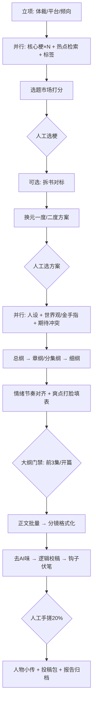

全文提炼的详细 Agent schema（与 `00-agent-catalog.md` 互补；实现时两者对照）。

# AI 商业化写作 · Agents 体系拆解报告


> 定位：产品与写作方法论 → 可落地多智能体系统，不写代码

---

## 1. 课程方法论总览

### 1.1 商业化写作标准工作流

课程反复强调的主线：

```
灵感/核心梗 → 框架（人设·世界观·文风）→ 总纲 → 章纲/分集纲 → 细纲 → 正文初稿（分段）→ 润色/去AI味 → 质检修稿 → 投稿
```

换元路径叠加一层：

```
对标文 → 拆书（参数）→ 一度/二度换元 → 新梗概 → 章纲/细纲对齐情绪 → 正文
```

漫剧路径（手册）：

```
核心梗(×10~100筛选) → 前10集集纲 → 分集正文 → AI校正 → 去AI味 → 手搓校稿 → 扩展后续大纲 → 总大纲+人物小传 → 循环至完稿
```

#### 各阶段：输入 / 输出 / 验收标准

| 阶段 | 输入 | 输出 | 验收标准（课程口径） |
|---|---|---|---|
| **灵感/核心梗** | 榜单、热点、对标文、题材偏好、一度/二度意向 | 1句话核心梗 + 标签 + 动机线 + 危机 + 开篇结构 | 有反转/期待感；冲主角；可100字测试；不脱离市场；爆点前置 |
| **选题/市场校验** | 平台、男/女频、体裁、榜单关键词 | 选题卡：赛道、差异化点、受众、红线检查 | 写读者要的而非自嗨；热点+情绪+深度；避开敏感/悬浮/同质化 |
| **拆书（参数）** | 对标 TXT(UTF-8)、拆书目的 | 综合梗概、章纲、细纲+节奏、人设、情绪曲线、七步法、核心梗 | 按单元故事拆；有效情节点可互校；情绪上下行可对齐仿写 |
| **换元** | 拆书结果 + 一度/二度指令 + 双重限定 | N个方案 → 选定方案 → 新故事梗概 | 一度：背景/人物/道具；二度：换核心事件；情绪链不丢；人决策方案 |
| **框架设定** | 梗概、体裁开关 | 人设卡、世界观规则、金手指边界、文风、势力 | 三位一体+反差；金手指有规则/限制；短篇可省略世界观等 |
| **期待感+矛盾** | 梗概 | 核心期待、1+3小期待、核心矛盾+升级路径、爽点清单 | 前2000–3000字亮核心期待；冲突冲主角、绝路、2–3次升级、反机械降神 |
| **情绪+节奏** | 章纲/细纲 | 情绪锚定、三轮拉扯、节奏量化表 | 展示非告知；章节/情节点密度达标；上下行与对标一致 |
| **总纲** | 梗概+设定 | 500–2000字故事大纲（起承转合） | 主线清晰；远期待打底近期待拉满 |
| **章纲/分集纲** | 总纲+爽点模型 | 章节/集表：内容、爽点、卡点、钩子 | 每章/集有推进；漫剧前10集强冲突；每集结尾钩子 |
| **细纲** | 章纲 | 每章6–8有效情节点 | 删则断线；情绪上下行对齐原文/方案 |
| **正文生成** | 细纲/集纲+格式 | 分段正文（2000–3000字/次或每集800–1200字） | 写一章改一章；剧本非小说化；字数宁多勿少后做减法 |
| **去AI味** | 初稿 | 润色稿 | 短句、禁套路比喻、人物口语化；朱雀/人工通读 |
| **质检** | 成稿+原对标参数 | 质检报告+改稿清单 | P0逻辑/人设/核心矛盾；P1情绪节奏伏笔人工；P2语言AI味 |
| **投稿包** | 质检通过稿 | 梗概+人物小传+大纲+正文至一卡 | 一稿一投规范；三级选题卡过后方可深写 |

### 1.2 体裁流程差异

| 维度 | 漫剧/短剧 | 短篇网文 | 女频中长篇 | IP改编 |
|---|---|---|---|---|
| **单元尺度** | 5–8个单元故事；常按100集四幕 | 1个单元故事≈1万字/≈12章 | 30–100个单元；卷纲+主副线 | 先拆原著单元再压缩搭积木 |
| **核心判断词** | **期待感**优先；每集钩子 | **情绪**优先 | 情绪驱动节奏；人设追读 | **情绪钩子密度 > 故事完整性** |
| **开篇** | 黄金三秒；前5集强冲突；debuff叠满 | 导语+开篇300–500字定生死 | 第1/10章抓留存 | 慢热开头改造、爽点前置 |
| **大纲粒度** | 核心梗→前10集纲→正文→扩展→总大纲+小传 | 梗概→章纲→细纲→逐章正文 | ≥8类前期报告（关系/情绪曲线/架构/伏笔等） | 减法拆书→加法重构→单集落地 |
| **正文形态** | 分镜画面+台词；场景≤3；台词≤500字/集 | 第一人称为主；短句密度高 | 第三人称常见；章2000–3000 | 视听化验证；付费卡点10/20级 |
| **节奏** | 1–3分钟/集；30秒推进 | 12×800×6–8情节点 | 爽点配比+缓冲；前快中稳后缓 | 冲突合并、过渡删除、人物合并 |
| **质检重点** | 小说化描述、镜头、钩子、审核擦边 | 情绪节奏对齐、AI直出拦截 | 中期疲软、油腻男主、节奏真空 | 不可动：主线目标/核心人设/金手指/世界规则 |
| **变现** | K档买断/保底；前三集方案不过不深写 | 买断K10–K20入门；多平台投 | 保底+追更；改编适配 | 选书数据门槛；改编价高于原创门槛 |

**新人路径（课程共识）**：短篇单元故事练手 → 漫剧/短剧 → 中长篇；先拆仿换元，后原创。

---

## 2. Agent 清单

> 约定：每个 Agent 的 **Prompt 锁定区** = 方法论/禁区/输出格式；**可变区** = 题材、对标、方案选择、批次参数。

---

### 2.1 Orchestrator · 主控编排 Agent（Orchestrator）

| 项 | 内容 |
|---|---|
| **名称** | 主控编排 / Orchestrator |
| **职责** | 选择体裁工作流模板；调度下游；维护 Project 状态机；汇总质检；决定放行/打回/并行批次 |
| **触发** | 用户新建项目；任一阶段完成回调；Grok同事建议插入任务时 |
| **输入 schema** | `project_id, genre[短篇\|漫剧\|短剧\|女频中长\|IP改编], stage, user_intent, constraints[], priority` |
| **输出 schema** | `next_agents[], parallel_batches[], gates_required[], human_checkpoints[], status` |
| **方法论** | 2.md工作流；3.md换元七步；ai漫剧流程；13.md改编三步法 |
| **Tools** | ProjectCRUD, Memory, KnowledgeQuery, AgentRouter, Queue |
| **门禁** | 体裁格式未选→拦截；核心梗未人工确认→禁止进正文；质检P0未清→禁止投稿包 |
| **批量** | 否（编排器）；可下发批量任务 |
| **Prompt** | 锁定：状态机与门禁表；可变：体裁模板、并行策略 |

---

### 2.2 CorePremiseAgent · 核心梗 Agent

| 项 | 内容 |
|---|---|
| **名称** | 核心梗生成 / Core Premise Agent |
| **职责** | 按市场约束批量生成核心梗；含标签、动机线、危机、开篇结构；支持四步组合法 |
| **触发** | 立项；热点更新；用户要求「再来N个」 |
| **输入** | `platform, gender_channel, hot_tags[], avoid_tags[], count(10\|20\|100), style_notes, seed_examples[]` |
| **输出** | `premises[{title, premise, tags[], motive_lines[], crisis, opening_structure, score_hint}]` |
| **方法论** | 手册§一；17.md四步法；ai漫剧流程；2.md核心梗vs情节卡 |
| **Tools** | HotTopicSearch, RankBoardFetch, GenreTagLib, PromptTemplate |
| **门禁** | 命中题材红线（真鬼/血腥/魔改名著等）→自动拦截；无反转/无期待→降权 |
| **批量** | **必须支持**（10/20/100） |
| **Prompt** | 锁定：注意事项+格式+受众；可变：题材列表、擦边尺度、男/女频 |

---

### 2.3 TopicMarketAgent · 选题/市场 Agent

| 项 | 内容 |
|---|---|
| **名称** | 选题市场评估 / Topic & Market Agent |
| **职责** | 扒榜规律、受众定位、差异化建议、平台口味匹配、同质化风险 |
| **触发** | 核心梗候选产出后；换元方案选定前；女频中长篇立项 |
| **输入** | `premises[], target_platform, audience_age, channel, competitor_titles[]` |
| **输出** | `market_report{hot_keywords[], fit_score, differentiation, risks[], recommend_action}` |
| **方法论** | 9.md四大选题技巧；14.md选题三原则；1.md合适题材 |
| **Tools** | RankBoardFetch, HotTopicSearch, KnowledgeDoc(榜单报告), WebSearch |
| **门禁** | 仅蹭热点无情绪深度→警告；敏感话题→硬拦截 |
| **批量** | 支持对N个梗并行打分 |
| **Prompt** | 锁定：避坑五条+精品化趋势；可变：平台、榜单窗口期 |

---

### 2.4 BookBreakdownAgent · 拆书/参数 Agent

| 项 | 内容 |
|---|---|
| **名称** | 拆书参数 / Book Breakdown（Parameter）Agent |
| **职责** | 四层拆书：综合/章纲/细纲+节奏/人设；七步法反拆；核心梗提取；情绪曲线数据 |
| **触发** | 选定对标；仿写前；IP改编减法阶段；自检成稿对比 |
| **输入** | `source_doc_id, purpose[框架\|节奏\|人设\|核心梗], granularity[合并\|分章], unit_range` |
| **输出** | `param_pack{meta, expectation, setting, conflicts[], emotion_curve[], relations, qibu, core_geng, plot_cards[], rhythm_metrics}` |
| **方法论** | 2.md参数模板；3.md四层拆；6.md小九猜书；13.md单元拆 |
| **Tools** | FileIngest(TXT UTF-8), KnowledgeDoc, EmotionCurveViz, DiffCompare |
| **门禁** | 格式非UTF-8→预处理；细纲与节奏互校不一致→强制复核；无目的全拆长篇→警告 |
| **批量** | 支持按10章合并批拆 |
| **Prompt** | 锁定：参数字段模板；可变：目的、章节范围 |

---

### 2.5 ElementSwapAgent · 换元 Agent（一度/二度）

| 项 | 内容 |
|---|---|
| **名称** | 换元法 / Element Substitution Agent |
| **职责** | 六元素诊断；一度（背景/人物/道具）或二度（核心事件）方案生成与映射 |
| **触发** | 拆书完成；用户指定置换目标 |
| **输入** | `param_pack, swap_level[1\|2], target_setting, forbid[](如科幻), scheme_count, hotspot_seed?` |
| **输出** | `schemes[{id, mapping, new_synopsis, rationale, similarity_risk}], recommended_id?` |
| **方法论** | 换元法.txt；3.md一度/二度与七步；仿写案例现→仙侠/现→现 |
| **Tools** | PromptTemplate(换元大师), HotTopicSearch, HumanChoiceUI |
| **门禁** | **方案必须人工选定**；二度核心事件老套→要求人工补热点/素材；换皮不换骨→拦截 |
| **批量** | 支持多方案；可对同一原文多背景并行 |
| **Prompt** | 锁定：六源+一度/二度定义+输出格式；可变：置换方向、禁止项 |

---

### 2.6 CharacterDesignAgent · 人设 Agent

| 项 | 内容 |
|---|---|
| **名称** | 人设设计 / Character Design Agent |
| **职责** | 三位一体、三字经、大五人格、欲望恐惧秘密、人设驱动剧情校验 |
| **触发** | 框架阶段；换元后人物需重建；质检人设崩 |
| **输入** | `synopsis, channel, roles_needed, big_five?, desire_fear_secret?, arc_required` |
| **输出** | `characters[{name, background, personality, behavior_logic, contrast, catchphrase, desire, fear, secret, arc}]` |
| **方法论** | 3.md人物；6.md人设五问；10.md大五人格；14.md女主三不能 |
| **Tools** | CharacterCardCRUD, RelationGraph, PromptTemplate |
| **门禁** | 背景-性格-行为矛盾→拦截；主角无情/反人类→警告；女频油腻男主→拦截建议 |
| **批量** | 可批量生成配角工具人卡 |
| **Prompt** | 锁定：三不能/人味底线；可变：频向、反差强度 |

---

### 2.7 WorldviewAgent · 世界观 Agent

| 项 | 内容 |
|---|---|
| **名称** | 世界观构建 / Worldview Agent |
| **职责** | 写「运行规则」非类型标签；困境上下限；金手指匹配；短篇可跳过 |
| **触发** | 漫剧/长篇/短剧框架；后悔流强制；IP改编锁定规则 |
| **输入** | `genre_type, gold_finger?, must_rules[], omit_if_known_ip` |
| **输出** | `world{rules[], difficulty_range, economy?, factions[], why_unique, emotion_binding}` |
| **方法论** | 12.md世界观三层；17.md世界观选主流 |
| **Tools** | KnowledgeDoc(设定库), ConsistencyChecker |
| **门禁** | 只写「末日/修仙」无规则→打回；金手指与世界冲突→拦截 |
| **批量** | 可多世界观变体对比 |
| **Prompt** | 锁定：规则>类型；可变：题材、是否省写 |

---

### 2.8 GoldFingerAgent · 金手指 Agent（建议独立，服务世界观/核心梗）

| 项 | 内容 |
|---|---|
| **名称** | 金手指设计 / Gold Finger Agent |
| **职责** | 限制型金手指、同级无敌/跨阶困难、驱动主动行动 |
| **触发** | 男频升级流；核心梗含系统；改编不可动校验 |
| **输入** | `world, premise, power_fantasy_level, limits_required` |
| **输出** | `gold_finger{name, mechanism, limits, growth_unlocks[], motivation_link}` |
| **方法论** | 12.md金手指三大要求；17.md带限制金手指 |
| **Tools** | ConsistencyChecker, KnowledgeDoc |
| **门禁** | 无限制无敌流长期难维持→警告 |
| **批量** | 支持多机制候选 |
| **Prompt** | 锁定：必须有规则边界；可变：类型（系统/空间/重生等） |

---

### 2.9 ExpectationConflictAgent · 期待感与冲突 Agent

| 项 | 内容 |
|---|---|
| **名称** | 期待感与矛盾冲突 / Expectation & Conflict Agent |
| **职责** | 1+3结构、远近期待、冲突六要素、升级路径、反机械降神 |
| **触发** | 梗概阶段；换元二度筛选；改稿P0 |
| **输入** | `synopsis, genre, existing_beats?` |
| **输出** | `core_expectation, small_hooks[3], core_conflict, upgrade_path[], check_six_elements{}, anti_deus_ex` |
| **方法论** | 4.md全文 |
| **Tools** | OutlineCRUD, LogicChecker |
| **门禁** | 开篇无核心期待→硬拦截进正文；合作共赢式爽文结局→警告 |
| **批量** | 可对100个梗批量打期待/矛盾分 |
| **Prompt** | 锁定：六要素口诀；可变：体裁侧重点 |

---

### 2.10 EmotionRhythmAgent · 情绪节奏 Agent

| 项 | 内容 |
|---|---|
| **名称** | 情绪与节奏 / Emotion & Rhythm Agent |
| **职责** | 锚定核心情绪；三轮拉扯；节奏四维；场景六要素；情绪曲线对比 |
| **触发** | 章纲/细纲阶段；仿写校准；女频节奏专项前 |
| **输入** | `outline, reference_curve?, core_emotion[爽\|虐\|甜\|…], chapter_metrics` |
| **输出** | `emotion_plan, pull_cycles[3], rhythm_scorecard, scene_element_plan, curve_json` |
| **方法论** | 5.md；3.md节奏量化；6.md曲线对比 |
| **Tools** | EmotionCurveViz, DiffCompare, OutlineCRUD |
| **门禁** | 与对标上下行偏离→重生成节点；属性飘忽/单调递增→拦截 |
| **批量** | 支持多章情绪标注批处理 |
| **Prompt** | 锁定：展示非告知+四维定义；可变：核心情绪、对标曲线 |

---

### 2.11 CoolPointFaceSlapAgent · 爽点打脸 Agent

| 项 | 内容 |
|---|---|
| **名称** | 爽点与装逼打脸 / Cool-Point & Face-Slap Agent |
| **职责** | 马斯洛12套路；装逼四要素；三阶打脸；18爽点模型映射到集/章 |
| **触发** | 分集/章纲填充爽点列；男频漫剧高能段 |
| **输入** | `beat_context, slap_tier[初\|中\|高\|自打脸], info_gap_map, maslow_need` |
| **输出** | `cool_beat{type, setup, payoff, psychology_arcs, intensity_1to10}` |
| **方法论** | 6/7.md；手册十八爽点 |
| **Tools** | BeatLibrary, OutlineCRUD |
| **门禁** | 无铺垫直接打脸→打回；擦边超审核→拦截 |
| **批量** | 可按集批量填爽点/卡点表 |
| **Prompt** | 锁定：四前提+信息差表；可变：阶位、套路叠加 |

---

### 2.12 MasterOutlineAgent · 总纲 Agent

| 项 | 内容 |
|---|---|
| **名称** | 总纲/故事大纲 / Master Outline Agent |
| **职责** | 500–2000字起承转合总纲；主线副线边界 |
| **触发** | 框架确认后；投稿包整理 |
| **输入** | `premise, characters, world, episode_or_chapter_summaries?` |
| **输出** | `master_outline{structure, word_count, main_plot, subplots[]}` |
| **方法论** | 2.md总纲定义；手册§五大纲格式 |
| **Tools** | OutlineCRUD, PromptTemplate |
| **门禁** | 无主线目标→拦截 |
| **批量** | 否（单项目一份） |
| **Prompt** | 锁定：字数与结构；可变：结构模板 |

---

### 2.13 ChapterOutlineAgent · 章纲 Agent

| 项 | 内容 |
|---|---|
| **名称** | 章纲 / Chapter Outline Agent |
| **职责** | 故事线章节安排；换元后改章纲并对齐情绪 |
| **触发** | 总纲后；换元搭结构 |
| **输入** | `master_outline, reference_chapter_outline?, swap_scheme?` |
| **输出** | `chapters[{no, summary, emotion_up_down, hooks}]` |
| **方法论** | 2/3.md章纲置换 |
| **Tools** | OutlineCRUD, DiffCompare |
| **门禁** | 情绪偏离对标→重生成 |
| **批量** | 可整卷生成后分段人工审 |
| **Prompt** | 锁定：仿情绪不仿文面；可变：方案 |

---

### 2.14 BeatSheetAgent · 细纲 Agent

| 项 | 内容 |
|---|---|
| **名称** | 细纲/情节点 / Beat Sheet Agent |
| **职责** | 每章有效情节点；3–5章一批置换/生成 |
| **触发** | 章纲通过后；正文前 |
| **输入** | `chapter_range(≤5), reference_beats?, scheme, density_target` |
| **输出** | `beats[{chapter, points[{id, content, type, emotion}]}]` |
| **方法论** | 3.md细纲批换；有效情节点定义 |
| **Tools** | OutlineCRUD, RhythmChecker |
| **门禁** | 单次>5章→自动拆批；情节点不足6→警告 |
| **批量** | **原生批量（3–5章/批）** |
| **Prompt** | 锁定：有效情节点标准；可变：批大小 |

---

### 2.15 EpisodeOutlineAgent · 分集大纲 Agent

| 项 | 内容 |
|---|---|
| **名称** | 分集大纲 / Episode Outline Agent |
| **职责** | 前10集表（内容/爽点/卡点）；100集四幕任务分配；后续扩展 |
| **触发** | 漫剧核心梗确认；扩展后续 |
| **输入** | `premise, cool_models[], act_template_100?, prior_10?, extend_from?` |
| **输出** | `episodes[{ep, content, cool_point, cliff, hook, scenes_max}]` |
| **方法论** | 手册§二/四；17.md四幕；11.md流程 |
| **Tools** | EpisodeCRUD, CoolPointLib, PromptTemplate |
| **门禁** | 前三集方案弱→**禁止写第4集起深稿**（课程硬规则）；无集尾钩子→打回 |
| **批量** | 支持10集一轮、后续10集扩展 |
| **Prompt** | 锁定：表头与卡点类型；可变：核心梗、参考案例 |

---

### 2.16 BatchProseAgent · 正文分章/分集批量 Agent

| 项 | 内容 |
|---|---|
| **名称** | 正文批量生成 / Batch Prose & Episode Draft Agent |
| **职责** | 按细纲/集纲分段生成；控制2000–3000字或集字数；写一章改一章循环 |
| **触发** | 细纲/集纲通过；用户确认批次 |
| **输入** | `format[短篇\|长篇\|短剧\|漫剧], unit_ids[], beats_or_episode, style, characters, world?` |
| **输出** | `drafts[{unit_id, text, word_count, notes}]` |
| **方法论** | 2.md输出限制；3.md逐章生成；ai漫剧§三 |
| **Tools** | LLMGenerate, Memory(窗口管理), ChapterCRUD |
| **门禁** | 未选格式→拦截；一次性全书→拒绝；未人工过上一章→可配置拦截下一章 |
| **批量** | **核心批量能力**；建议串行质检后并行下一批 |
| **Prompt** | 锁定：分段限制+体裁开关；可变：文风、修改意见 |

---

### 2.17 StoryboardFormatAgent · 剧本分镜格式 Agent

| 项 | 内容 |
|---|---|
| **名称** | 剧本分镜格式化 / Storyboard Format Agent |
| **职责** | 小说化→分镜画面+台词；去形容词；画面详述 |
| **触发** | 漫剧正文初稿后；投稿前格式统一 |
| **输入** | `episode_draft, max_scenes=3, max_dialogue_words=500` |
| **输出** | `storyboard[{shot, visual, lines[{char, emotion, text}]}]` |
| **方法论** | 手册§三；ai漫剧修订提示词 |
| **Tools** | FormatValidator, EpisodeCRUD |
| **门禁** | 残留小说叙述/过多形容词→打回；场景>3→警告压缩 |
| **批量** | 支持按集批处理 |
| **Prompt** | 锁定：分镜格式范例；可变：集内容 |

---

### 2.18 DeAIFlavorAgent · 去AI味 Agent

| 项 | 内容 |
|---|---|
| **名称** | 去AI味润色 / De-AI Flavor Agent |
| **职责** | 按V3.8原则润色：短句、禁比喻套路、口语化、外化情绪 |
| **触发** | 正文/分镜后；朱雀高风险时 |
| **输入** | `text, preserve_plot=true, version=3.8` |
| **输出** | `polished_text, change_log[], checklist_pass` |
| **方法论** | 去ai味儿.md；ai漫剧§五；6.md检测工具仅参考 |
| **Tools** | PromptTemplate(3.8), AIDetector(朱雀可选), Diff |
| **门禁** | 改变主题/删关键场景→**硬拦截回滚**；通篇AI直出未润色→投稿拦截 |
| **批量** | 支持按章/集；忌全文一次无检 |
| **Prompt** | **几乎全锁定**（原则+禁用表达）；可变：仅原文 |

---

### 2.19 LogicProofAgent · 逻辑校稿 Agent

| 项 | 内容 |
|---|---|
| **名称** | 逻辑校稿 / Logic Proofreading Agent |
| **职责** | P0框架：主线、人设、设定自洽、伏笔回收、机械降神 |
| **触发** | 每10集/每若干章；完稿前；改稿循环过多时回溯框架 |
| **输入** | `manuscript_slice, bible{characters,world,outline}, foreshadow_ledger` |
| **输出** | `issues[{severity, type, evidence, fix_hint}], p0_clear:boolean` |
| **方法论** | 3.md质检优先级；4.md反机械降神；ai漫剧手动校稿 |
| **Tools** | ConsistencyChecker, ForeshadowLedger, KnowledgeGraph |
| **门禁** | P0未清→禁止下一阶段；AI自认无法识别的情节漏洞→**强制人工** |
| **批量** | 可切片并行，合并报告 |
| **Prompt** | 锁定：P0清单；可变：检查范围 |

---

### 2.20 HookForeshadowAgent · 钩子/伏笔 Agent

| 项 | 内容 |
|---|---|
| **名称** | 钩子与伏笔 / Hook & Foreshadow Agent |
| **职责** | 从爽点反推钩子；每集/章结尾钩子；伏笔埋收台账 |
| **触发** | 大纲阶段；分集生成后；校稿§钩子检查 |
| **输入** | `cool_points[], episode_or_chapter, mode[反推\|补钩\|查漏]` |
| **输出** | `hooks[], foreshadows[{plant, payoff_ep, status}], missing[]` |
| **方法论** | 4.md反向思维；17.md结尾钩子；ai漫剧校稿5 |
| **Tools** | ForeshadowLedger, EpisodeCRUD |
| **门禁** | 冲突升级链中乱埋无关伏笔→拦截；有埋无收→P1人工 |
| **批量** | 可批量为N集生成钩子候选 |
| **Prompt** | 锁定：钩子类型库；可变：本集内容 |

---

### 2.21 CharacterBioAgent · 人物小传 Agent

| 项 | 内容 |
|---|---|
| **名称** | 人物小传 / Character Bio Agent |
| **职责** | 投稿格式人物小传（身份、性格、关系、弧光） |
| **触发** | 大纲稳定后；手册§五整理阶段 |
| **输入** | `premise, all_episode_outlines, character_cards` |
| **输出** | `bios[{name, role, bio_text, tags, relations}]` |
| **方法论** | 手册人物小传格式；11.md |
| **Tools** | CharacterCardCRUD, PromptTemplate |
| **门禁** | 与正文人设冲突→打回角色卡 |
| **批量** | 一次输出全员小传 |
| **Prompt** | 锁定：小传字段；可变：剧情摘要 |

---

### 2.22 ImitationAgent · 仿写 Agent

| 项 | 内容 |
|---|---|
| **名称** | 仿写训练 / Imitation Writing Agent |
| **职责** | 1:1节奏复刻；情绪曲线对齐；洗稿定基调分段迭代（非推荐个人主业） |
| **触发** | 新人训练；商业仿写订单；性转等简单仿写 |
| **输入** | `source_param, imitation_goal[节奏\|情绪\|结构], swap_level?` |
| **输出** | `imitation_plan, draft_units[], curve_compare_result` |
| **方法论** | 3.md洗稿/换元；6.md先拆再仿；ai漫剧仿写30篇 |
| **Tools** | BookBreakdown, EmotionCurveViz, BatchProse, DeAI |
| **门禁** | AI直出交稿→拦截；相似度过高需二度或人工改 |
| **批量** | 支持多章仿写队列 |
| **Prompt** | 锁定：仿节奏情绪非文面抄袭声明；可变：目标层 |

---

### 2.23 IPAdaptAgent · IP改编压缩 Agent

| 项 | 内容 |
|---|---|
| **名称** | IP改编压缩重构 / IP Adaptation Agent |
| **职责** | 选书评估；减法拆单元；情绪量化；搭积木；压缩策略；单集节奏公式 |
| **触发** | 用户选IP；改编项目类型 |
| **输入** | `ip_meta{data_threshold, genre, structure_fit}, source_text, target_eps, preserve{goal,chars,finger,rules}` |
| **输出** | `adapt_plan{units_kept[], merges[], deletes[], new_episode_map[], emotion_scores[]}` |
| **方法论** | 13.md改编三步法；12.md重构非翻译；4.md魔改vs改 |
| **Tools** | BookBreakdown, EmotionCurve, EpisodeOutline, Storyboard |
| **门禁** | 动主线目标/核心人设/金手指/世界规则→**硬拦截**；魔改经典情节→红线 |
| **批量** | 单元故事可并行评估去留 |
| **Prompt** | 锁定：能改/不能改边界；可变：压缩比、目标集数 |

---

### 2.24 FemaleRhythmAgent · 女频节奏 Agent

| 项 | 内容 |
|---|---|
| **名称** | 女频节奏 / Female-Channel Rhythm Agent |
| **职责** | 爽点配比、缓冲剧情、三阶段节奏、留存节点、大女主独立事件校验 |
| **触发** | 女频中长篇；女频漫剧大纲 |
| **输入** | `outline, word_target, retain_checkpoints[1,10,50,100], emotion_mix` |
| **输出** | `rhythm_plan{cool_ratio, buffers[], stage_speeds, chapter_hooks_flags, risks[]}` |
| **方法论** | 14/15.md女频；17.md女频强情绪 |
| **Tools** | OutlineCRUD, MarketReport, EmotionRhythm |
| **门禁** | 女主依赖男主解决核心矛盾→打回；油腻爹味男主→拦截；节奏真空/爽点堆砌→警告 |
| **批量** | 可按卷生成节奏表 |
| **Prompt** | 锁定：情绪驱动节奏；可变：赛道（古言/现言等） |

---

### 2.25 GenreTagAgent · 题材标签 Agent

| 项 | 内容 |
|---|---|
| **名称** | 题材标签 / Genre Tag Agent |
| **职责** | 规范化标签、多梗叠加、红黑榜过滤、表现形式匹配（仿真人/2D/3D） |
| **触发** | 核心梗生成前后；投稿元数据 |
| **输入** | `premise_text, channel, year_context` |
| **输出** | `tags[], stacked_tropes[], form_recommend, blacklist_hits[]` |
| **方法论** | 手册题材；17.md红线；12.md不推荐题材 |
| **Tools** | TagTaxonomy, HotTopicSearch |
| **门禁** | 黑名单题材→拦截或强警告 |
| **批量** | 对N个梗打标 |
| **Prompt** | 锁定：红黑榜；可变：当月推荐题材 |

---

### 2.26 HotTopicSearchAgent · 热点检索 Agent

| 项 | 内容 |
|---|---|
| **名称** | 热点检索 / Hot Topic Search Agent |
| **职责** | 检索短视频/榜单/社会热点；为二度换元与选题提供素材种子 |
| **触发** | 选题；二度换元；跟热点策略 |
| **输入** | `keywords[], platforms[], time_window, emotion_bind_required` |
| **输出** | `hotspots[{title, source, emotion_hook, expire_risk, adapt_ideas[]}]` |
| **方法论** | 9.md热点+情绪+深度；3.md滑雪场案例；17.md跟热点投快公司 |
| **Tools** | WebSearch, RankBoardFetch, XSearch(可选) |
| **门禁** | 纯蹭无深度→降权；政策敏感→过滤 |
| **批量** | 多关键词并行 |
| **Prompt** | 锁定：必须绑定情绪冲突点；可变：领域 |

---

### 2.27 ReportAnalysisAgent · 报告分析 Agent

| 项 | 内容 |
|---|---|
| **名称** | 报告分析 / Report Analysis Agent |
| **职责** | 产出市场分析、拆书报告、情绪节奏曲线报告、人物关系递进、伏笔台账、架构报告等 |
| **触发** | 女频长篇立项前；定期行情；完稿复盘 |
| **输入** | `report_type, project_id\|market_scope, source_docs[]` |
| **输出** | `report_md, structured_tables{}, recommendations[]` |
| **方法论** | 14.md八类前期报告；9.md扒榜；2.md参数 |
| **Tools** | KnowledgeDoc, EmotionCurve, GraphExport, ProjectCRUD |
| **门禁** | 长篇无架构/情绪报告禁止开写正文（可配置） |
| **批量** | 可定时批量出榜单报告 |
| **Prompt** | 锁定：报告模板字段；可变：类型与时间窗 |

---

### 2.28 StyleExtractAgent · 文风抽取 Agent（支撑仿写/正文）

| 项 | 内容 |
|---|---|
| **名称** | 文风抽取 / Style Extract Agent |
| **职责** | 抽氛围/叙事/语气/节奏等成规则，避免直接丢原文过像 |
| **触发** | 仿写前；用户要「只要文风」 |
| **输入** | `sample_text, purpose[仿写\|仅文风]` |
| **输出** | `style_rules{}, consistency_check_q` |
| **方法论** | 2.md文风抽取技巧 |
| **Tools** | PromptTemplate, KnowledgeDoc |
| **门禁** | 目的=洗稿高相似→需合规确认 |
| **批量** | 多样本可合并规则 |
| **Prompt** | 锁定：要素清单；可变：样本 |

---

### 2.29 DialoguePolishAgent · 台词优化 Agent（漫剧）

| 项 | 内容 |
|---|---|
| **名称** | 台词优化 / Dialogue Polish Agent |
| **职责** | 台词推动情节、标签化、金句、人设符合；可选手册台词提示词 |
| **触发** | 分镜后；校稿人物语言 |
| **输入** | `storyboard, character_voices, max_words` |
| **输出** | `lines_revised[], push_plot_flags` |
| **方法论** | 11.md台词；手册优化台词提示词 |
| **Tools** | EpisodeCRUD, CharacterCard |
| **门禁** | 台词不推动情节→打回 |
| **批量** | 按集 |
| **Prompt** | 锁定：推进情节原则；可变：人设口吻 |

---

### 2.30 ImmersionAgent · 代入感诊断 Agent

| 项 | 内容 |
|---|---|
| **名称** | 代入感诊断 / Immersion QA Agent |
| **职责** | 五维：失真/扁平/弧线/紧迫感/反派威胁；过滤词与表现力 |
| **触发** | 质检P1；编辑反馈「代入感不强」 |
| **输入** | `text_slice, character_bible` |
| **输出** | `immersion_issues[], rewrite_directives[]` |
| **方法论** | 6.md代入感 |
| **Tools** | FilterWordScanner, LogicProof |
| **门禁** | 严重OOC→P0升级 |
| **批量** | 分章扫描 |
| **Prompt** | 锁定：五维清单；可变：文本 |

---

### 2.31 ProactiveColleagueAgent · Grok式主动同事 Agent

| 项 | 内容 |
|---|---|
| **名称** | 主动找活同事 / Proactive Colleague Agent |
| **职责** | 监控项目缺口：缺钩子、缺市场报告、榜单过期、情绪曲线未对比、伏笔未收、热点窗口将过期；主动提案任务 |
| **触发** | 定时；Project状态变更；用户闲置 |
| **输入** | `project_snapshot, last_activity, market_clock` |
| **输出** | `proposals[{task, why, agent, urgency, auto_start?}]` |
| **方法论** | 课程「判断与选择是核心能力」+「拆和练」循环；17.md预测热点 |
| **Tools** | Orchestrator API, HotTopicSearch, ReportAnalysis, ForeshadowLedger |
| **门禁** | 不可绕过人工核心决策（选梗/选方案/投稿）；不可自动外发投稿 |
| **批量** | 可一次提出多任务组队 |
| **Prompt** | 锁定：只提案不越权投稿；可变：主动程度 |

---

## 3. 多智能体编排

### 3.1 主控 Orchestrator 串流程（状态机）



**短篇捷径**：S1→H1→拆书换元→章纲细纲→正文→去AI→质检。  
**漫剧全量**：核心梗筛选加重；前10集闭环后再扩展。  
**女频中长**：S0后强制 ReportAnalysis（架构/情绪/关系等）再进正文。  
**IP改编**：选书→IPAdapt减法→重构分集→视听化→正文。

### 3.2 Grok-like「主动找活」介入点

| 场景 | 主动行为 |
|---|---|
| 核心梗停留>24h未选型 | 拉取新榜+再生成10梗+对比报告 |
| 二度换元事件老套 | 检索热点种子并附「滑雪场式」置换灵感 |
| 写到第11集未扩展大纲 | 提案扩展10集并预填爽点 |
| 情绪曲线与对标偏离 | 拉起 EmotionRhythm 重算并标红章节 |
| 伏笔台账有超时未收 | 提醒插入回收集 |
| 热点窗口将关闭 | 建议改投「过稿快」路径或转向预测选题 |
| 用户连续AI直出 | 强制插入 DeAI + 人工检查点 |

原则：**提案 → Orchestrator排队 → 关键节点仍人工**。

### 3.3 并行可组队场景

| 组队 | Agents | 说明 |
|---|---|---|
| A | CorePremise×10–100 ∥ HotTopic ∥ GenreTag | 立项爆发式选梗 |
| B | TopicMarket 对N梗打分 ∥ ExpectationConflict 打分 | 双维排序后人工选 |
| C | CharacterDesign ∥ Worldview ∥ GoldFinger | 框架并行 |
| D | CoolPoint 填爽点表 ∥ HookForeshadow 填钩子 | 分集表两列并行 |
| E | BatchProse 多章队列（章间串行质检） | 控质量 |
| F | DeAI ∥ LogicProof 切片 | 润色与逻辑可并行后合并 |
| G | ReportAnalysis（市场）∥ BookBreakdown（对标） | 长篇立项包 |
| H | IPAdapt 多单元去留评估并行 | 改编压缩 |

---

## 4. 知识库需求（从课程推导）

### 4.1 拆书模板字段（参数包）

| 字段 | 说明 |
|---|---|
| meta | 题材、类型、字数、平台、对标名 |
| synopsis | 故事梗概 |
| expectation | 大/小期待、近/远期待 |
| setting | 背景、主角配角 |
| core_contents | 脉络（非核心梗） |
| conflicts[] | 核心冲突列表 |
| emotion_curve[] | 章/集情绪值与上下行 |
| relations | 人物关系 |
| reversals[] | 反转 |
| qichengzhuanhe | 起承转合 |
| qibu | 目标-阻碍-行动-结果-意外-转折-结局 |
| rhythm | 章数、字数、情节点密度 |
| core_geng | 抽象情绪链核心梗 |
| plot_cards[] | 较死板流程卡（可选） |
| style | 整体风格 |
| 5W1H | Who/What/When/Where/Why/How |

### 4.2 桥段/套路库

- 核心梗类型：爽点/情感/转折；追妻「虐毁追合」  
- 爽点12套路 + 手册18爽点模型  
- 装逼打脸三阶+信息差配置  
- 开场类型库、集尾钩子手段库  
- 女频差异化人设组合库  
- 换元方案库（背景/人物/事件/道具…）  
- 不推荐/红线题材库（按月版本化）

### 4.3 报告类型

| 报告 | 用途 |
|---|---|
| 市场/榜单分析报告 | 选题、标签、跟热点 |
| 拆书报告（参数包） | 仿写/换元输入 |
| 情绪节奏曲线报告 | 仿写校准、长篇节奏 |
| 人物关系递进报告 | 女频中长篇 |
| 架构/总纲/卷纲报告 | 防中期崩 |
| 伏笔埋收报告 | 质检 |
| 换元方案对比报告 | 人工选型 |
| 代入感/逻辑质检报告 | 改稿 |
| 改编压缩方案报告 | IP项目 |
| 完稿复盘报告 | 知识沉淀 |

### 4.4 知识图谱建议

**节点**：Work, UnitStory, Chapter/Episode, Beat, Character, Relation, WorldRule, GoldFinger, Trope/CoreGeng, EmotionBeat, Hook, Foreshadow, CoolPoint, Tag, Platform, HotTopic, PromptTemplate, Report  

**边示例**：  
`Work-CONTAINS→UnitStory`；`UnitStory-HAS→Beat`；`Character-RELATES{type}→Character`；`Beat-TRIGGERS→Emotion`；`Hook-PAYS_OFF_IN→Episode`；`Foreshadow-RESOLVES_IN→Beat`；`Premise-STACKS→Trope`；`Scheme-MAPS_FROM→SourceElement`；`Episode-USES→CoolPointModel`

---

## 5. 业务实体与 CRUD 字段建议

### 5.1 Project

| 字段 | 类型建议 |
|---|---|
| id, title, genre, channel(男/女), platform | |
| status(枚举阶段), swap_level(0/1/2) | |
| premise_id, source_work_id(对标/IP) | |
| format_switch(短篇/长篇/短剧/漫剧) | |
| target_words / target_episodes | |
| market_score, human_gates_passed[] | |
| created_at, updated_at, owner_id | |

### 5.2 Episode（漫剧/短剧）

`id, project_id, ep_no, act(1-4), content_outline, cool_point, cliff_card, ending_hook, scenes[], draft_text, storyboard_json, word_count, qa_status, foreshadow_ids[]`

### 5.3 Chapter（网文）

`id, project_id, vol_no, chap_no, outline, beats[], emotion_up_down, draft_text, polished_text, rhythm_metrics, qa_status`

### 5.4 PromptTemplate

`id, name, version(如去AI3.8), agent_type, locked_body, variable_slots[], dual_constraints[], examples[], locale`

### 5.5 Memory（会话/项目记忆）

`id, project_id, window_topic, summary, bible_snapshot, last_decisions[], taboo_notes(如勿科幻), token_budget_hint`

### 5.6 KnowledgeDoc

`id, type(拆书\|榜单\|桥段\|报告\|案例), title, tags[], body, param_pack_json, source_file, embedding_ref, valid_until(热点类)`

### 5.7 其他建议实体

- **PremiseCandidate**：核心梗候选与评分  
- **SwapScheme**：换元方案与元素映射  
- **CharacterCard / CharacterBio**  
- **WorldBible / GoldFinger**  
- **ForeshadowLedger**  
- **EmotionCurve**  
- **MarketReport**  
- **QAIssue**  
- **SubmissionPackage**（梗概+小传+大纲+正文切片）

**CRUD 原则**：核心人工决策字段（选定梗、选定换元方案、投稿确认）仅 Update 经人；Agent 可 Create 候选与 Draft；Delete 软删并留审计。

---

## 附录：课程→Agent 速查

| 课次/资料 | 主要喂给的 Agent |
|---|---|
| 1.md | Orchestrator路径、新人阶段门禁 |
| 2.md | 拆书、提示词规则、总章细纲、BatchProse |
| 3.md / 换元法.txt | ElementSwap、仿写、质检优先级 |
| 4.md | ExpectationConflict、HookForeshadow |
| 5.md | EmotionRhythm |
| 6–7.md | CoolPointFaceSlap、Immersion、拆书工具 |
| 8.md | 灵感四层级→Orchestrator入口路由 |
| 9.md | TopicMarket、HotTopic |
| 10.md | CharacterDesign |
| 11–12,17 + 手册 + ai漫剧流程 | CorePremise、EpisodeOutline、Storyboard、Bio、Batch |
| 13.md | IPAdapt |
| 14–15.md | FemaleRhythm、ReportAnalysis |
| 去ai味儿.md | DeAIFlavor |

---

**产品落地一句话**：把课程里「人负责判断与选择、AI负责分层生成与检测」固化为 **Orchestrator + 门禁 + 可批量候选 Agents**；凡涉及**选梗、选换元方案、情绪节奏终审、投稿**，必须保留人工卡点——这与训练营对「AI直出必拒」的行业经验一致。
